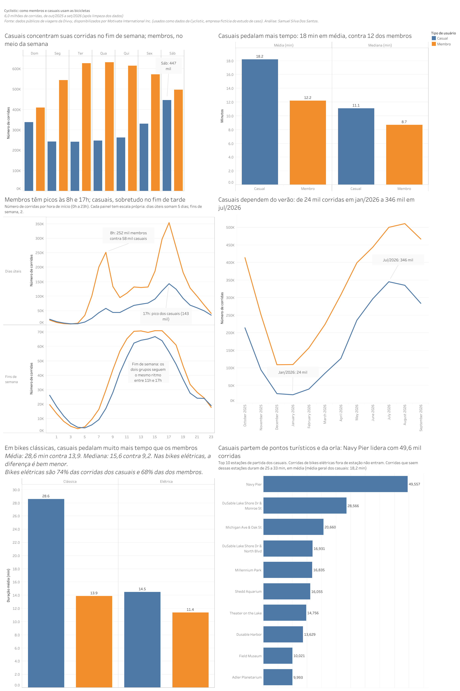

# 🚲 Cyclistic: como membros anuais e ciclistas casuais usam as bicicletas de forma diferente

> Estudo de caso 1 do **Certificado Profissional de Análise de Dados do Google**.
> Análise de **mais de 6 milhões de corridas** (out/2025 a set/2026) com **Python, SQL (BigQuery), Google Sheets e Tableau**, seguindo as seis etapas do processo de análise de dados: **Perguntar, Preparar, Processar, Analisar, Compartilhar e Agir**.

🔗 **Painel interativo no Tableau Public:** [Ciclist: Painel 1](https://public.tableau.com/app/profile/samuel.silva2287/viz/Ciclist/Painel1)



> ⚠️ **Cyclistic é uma empresa fictícia**, criada para o estudo de caso. Os dados reais de viagens são da **Divvy** (sistema de bicicletas compartilhadas de Chicago), disponibilizados por Motivate International Inc.

---

## Principais achados

| | **Ciclistas casuais** | **Membros anuais** |
|---|---|---|
| Participação nas corridas | 35,1% (2.110.304) | 64,9% (3.896.850) |
| Duração média / mediana | 18,2 / 11,1 min | 12,2 / 8,7 min |
| Dia de maior uso | Sábado (447 mil corridas) | Quarta-feira (631 mil corridas) |
| Corridas no fim de semana | 37,2% do total do grupo | 23,3% do total do grupo |
| Horários de pico em dias úteis | 17h (sem pico forte pela manhã) | 8h e 17h |
| Sazonalidade (mês mais forte ÷ mais fraco) | 14,5x | 4,7x |
| Corridas em jun-ago | 46% do total do grupo | 37% do total do grupo |
| Bike clássica: duração média / mediana | 28,6 / 15,6 min | 13,9 / 9,2 min |
| Locais de partida mais usados | Pontos turísticos e da orla do lago | Não analisado |

**Em uma frase:** os membros usam a Cyclistic com regularidade ao longo do ano, em corridas curtas e concentradas nos horários de pico em dias úteis; os casuais usam de forma mais sazonal, com mais corridas no verão e nos fins de semana, corridas mais longas e partidas concentradas em pontos turísticos da orla. Ainda assim, **63% das corridas dos casuais acontecem em dias úteis** e o pico deles às 17h indica que parte desse grupo pode ter perfil parecido com o dos membros.

---

## Sumário

1. [Contexto e tarefa de negócio (Perguntar)](#1-contexto-e-tarefa-de-negócio-perguntar)
2. [Fontes de dados (Preparar)](#2-fontes-de-dados-preparar)
3. [Ferramentas utilizadas](#3-ferramentas-utilizadas)
4. [Limpeza e transformação dos dados (Processar)](#4-limpeza-e-transformação-dos-dados-processar)
5. [Análise (Analisar)](#5-análise-analisar)
6. [Visualizações (Compartilhar)](#6-visualizações-compartilhar)
7. [Conclusão e recomendações (Agir)](#7-conclusão-e-recomendações-agir)
8. [Limitações](#8-limitações)
9. [Próximos passos e dados adicionais](#9-próximos-passos-e-dados-adicionais)
10. [Como reproduzir a análise](#10-como-reproduzir-a-análise)
11. [Estrutura sugerida do repositório](#11-estrutura-sugerida-do-repositório)
12. [Aprendizados](#12-aprendizados)
13. [Autor e créditos](#13-autor-e-créditos)

---

## 1. Contexto e tarefa de negócio (Perguntar)

### Cenário

Sou analista de dados júnior na equipe de análise de marketing da **Cyclistic**, uma empresa de bicicletas compartilhadas de Chicago. A diretora de marketing, **Lily Moreno**, acredita que o crescimento futuro depende de **maximizar o número de assinaturas anuais**. Segundo os analistas financeiros, os membros anuais são muito mais lucrativos que os ciclistas casuais (quem compra passes de corrida única ou de dia inteiro).

Em vez de buscar clientes totalmente novos, a proposta é **converter casuais em membros**, já que eles conhecem o serviço e já o escolheram para se locomover.

### Partes interessadas

- **Lily Moreno**, diretora de marketing e gestora direta.
- **Equipe de análise de marketing da Cyclistic**, responsável por coletar, analisar e reportar os dados.
- **Equipe executiva**, que decide se aprova o programa de marketing e exige recomendações apoiadas em dados e visualizações profissionais.

### Três perguntas que guiam o programa de marketing

1. **Como membros anuais e ciclistas casuais usam as bicicletas de forma diferente?** ← *esta análise*
2. Por que os casuais comprariam uma assinatura anual?
3. Como a Cyclistic pode usar mídia digital para influenciar os casuais a virarem membros?

### Declaração da tarefa de negócio

> **Identificar como membros anuais e ciclistas casuais utilizam as bicicletas da Cyclistic de forma diferente, para embasar uma estratégia de marketing que converta ciclistas casuais em membros anuais.**

Este estudo responde à pergunta 1. As perguntas 2 e 3 ficam fora do escopo, mas as recomendações da [seção 7](#7-conclusão-e-recomendações-agir) já apontam caminhos para elas.

### Hipóteses iniciais

- Membros pedalam mais em **dias úteis** e em **horários de pico** (deslocamento ao trabalho).
- Casuais pedalam mais em **fins de semana** e fazem corridas **mais longas**.

---

## 2. Fontes de dados (Preparar)

### Origem

- **Dados históricos de viagens da Divvy** (sistema de bicicletas compartilhadas de Chicago), usados como se fossem da Cyclistic. Página de dados do sistema: <https://divvybikes.com/system-data>. Os dados são públicos e licenciados por **Motivate International Inc.** (veja o [acordo de licença](https://divvybikes.com/data-license-agreement)).
- **Período:** 12 meses completos, de **outubro de 2025 a setembro de 2026**.
- **Formato:** 1 arquivo CSV por mês. O arquivo de julho/2026 (165 MB) foi dividido em 2 partes, resultando em **14 arquivos** carregados.
- **Volume:** **6.557.066 linhas** carregadas na tabela bruta.

### Organização dos arquivos

Os arquivos foram descompactados e os **originais ficaram guardados, sem alteração**, em uma pasta separada, com nomes no padrão `AAAAMM-divvy-tripdata.csv`.

### Estrutura dos dados (13 colunas)

| Coluna | Descrição |
|---|---|
| `ride_id` | Identificador único da corrida |
| `rideable_type` | Tipo de bicicleta (`classic_bike` ou `electric_bike`) |
| `started_at` / `ended_at` | Data e hora de início e de fim da corrida |
| `start_station_name` / `start_station_id` | Estação de início |
| `end_station_name` / `end_station_id` | Estação de fim |
| `start_lat` / `start_lng` | Coordenadas do início |
| `end_lat` / `end_lng` | Coordenadas do fim |
| `member_casual` | Tipo de usuário (`member` = membro anual, `casual` = passe avulso ou de dia inteiro) |

### Avaliação da credibilidade dos dados (ROCCC)

| Critério | Avaliação |
|---|---|
| **R**eliable (confiável) | Dados gerados automaticamente pelo sistema de bikes, mas continham **duplicados** e **registros inválidos**, tratados na [seção 4](#4-limpeza-e-transformação-dos-dados-processar). |
| **O**riginal | Dados primários, coletados pela própria operadora do sistema. |
| **C**omprehensive (abrangente) | Cobrem todas as corridas do período, mas **não trazem informações sobre o cliente** (idade, residência, preço pago, finalidade da viagem). |
| **C**urrent (atual) | Últimos 12 meses completos, de out/2025 a set/2026. |
| **C**ited (citado) | Fonte pública identificada, com licença de uso. |

### Privacidade e licença

Os dados **não contêm informações pessoais**. Isso significa que não é possível ligar corridas a uma pessoa, descobrir se um casual mora na área de serviço ou se comprou vários passes avulsos. Essa restrição está registrada nas [limitações](#8-limitações).

---

## 3. Ferramentas utilizadas

Os arquivos mensais têm centenas de milhares de linhas cada, e o ano completo passa de 6 milhões. O Google Sheets e o Excel não comportam esse volume (o Sheets limita a 10 milhões de células por planilha), então cada ferramenta entrou onde fazia mais sentido:

| Etapa | Ferramenta | Uso |
|---|---|---|
| Preparar | **Python (pandas)** | Divisão do arquivo de julho/2026, que passava do limite de ~100 MB de upload do BigQuery |
| Processar | **Google BigQuery (SQL)** | Carga dos 14 arquivos, validação, remoção de duplicados e inválidos, criação de colunas |
| Analisar | **Google BigQuery (SQL)** | Consultas de agregação (por dia, hora, mês, tipo de bike e estação) |
| Analisar / Compartilhar | **Google Sheets** | Armazenamento dos resultados agregados e fonte de dados do Tableau |
| Compartilhar | **Tableau Public** | Gráficos e painel final |

---

## 4. Limpeza e transformação dos dados (Processar)

### Estratégia em três camadas

Os dados brutos **nunca foram alterados**. Cada etapa gerou uma tabela nova no BigQuery, o que torna o processo reproduzível e auditável:

| Tabela | Conteúdo |
|---|---|
| `trips_raw` | Dados brutos, exatamente como nos arquivos |
| `trips_clean` | Período corrigido e duplicados removidos |
| `trips_final` | Registros inválidos removidos e novas colunas criadas |

> Obs.: o dataset foi criado com o nome `cyclistc` (sem o "i"), e as consultas deste repositório usam esse nome.

### Carga e validação inicial

- Esquema definido manualmente (`started_at` e `ended_at` como `TIMESTAMP`, IDs de estação como `STRING`, coordenadas como `FLOAT`), porque o formato dos IDs varia entre os meses e a detecção automática poderia falhar.
- Carga mês a mês na mesma tabela (opção *Append*), ignorando a linha de cabeçalho.
- **Verificação:** a soma das corridas por mês bateu com o total da tabela, **6.557.066 linhas**, confirmando que nenhuma linha se perdeu nos uploads.

### Resumo das etapas de limpeza

| Etapa | Regra aplicada | Linhas removidas | Linhas restantes |
|---|---|---:|---:|
| Carga | 14 arquivos em `trips_raw` | – | **6.557.066** |
| 1 | Filtro de período (out/2025 a set/2026) | 71 | 6.556.995 |
| 2 | Remoção de duplicados exatos | 385.316 | 6.171.679 |
| 3 | Remoção de durações inválidas | 164.525 | **6.007.154** |

**Total removido: 549.912 linhas (8,4%).** Base final de análise: **6.007.154 corridas**.

### Etapa 1: filtro de período

A contagem por mês mostrou **71 corridas de setembro de 2025**, presentes no arquivo de outubro (corridas iniciadas antes de 1º de outubro). Elas foram removidas para fechar o período em exatamente 12 meses.

### Etapa 2: duplicados

- A contagem de IDs distintos (6.171.679) era menor que a de linhas (6.556.995), ou seja, havia **385.316 linhas repetidas**.
- A contagem por mês mostrou onde estavam:

| Mês | Linhas | IDs distintos | Repetidos |
|---|---:|---:|---:|
| set/2026 | 1.155.763 | 770.511 | 385.252 |
| abr/2026 | 448.287 | 448.252 | 35 |
| ago/2026 | 868.098 | 868.069 | 29 |

- **Todas as repetições são cópias exatas** (o número de linhas distintas considerando todas as colunas é igual ao de IDs distintos), então a remoção com `SELECT DISTINCT` é segura.
- **Causa provável:** os repetidos de setembro equivalem a cerca de metade dos IDs do mês, o que sugere que uma das partes do arquivo foi carregada duas vezes. As poucas repetições de abril e agosto provavelmente já existiam nos arquivos originais.

### Etapa 3: durações inválidas

| Problema | Regra | Linhas |
|---|---|---:|
| Duração negativa | Fim antes do início (erro de registro) | 29 |
| Menos de 1 minuto | Possíveis retiradas canceladas ou bikes devolvidas na hora | 159.192 |
| 24 horas ou mais | Possíveis bikes perdidas ou não devolvidas | 5.304 |
| **Total** | | **164.525** |

Os três grupos não se sobrepõem. Os limites de 60 segundos e 24 horas são uma **decisão de análise**, e podem ser revistos.

### O que foi mantido de propósito

- **Corridas sem estação:** 1.289.469 sem estação de início e 1.355.444 sem estação de fim (na tabela `trips_clean`). **100% das corridas sem estação de início são de `electric_bike`**, que pode ser deixada fora de uma estação (cerca de 29% das corridas elétricas). Removê-las distorceria a comparação entre os grupos, então elas permanecem em todas as análises, exceto na de estações.
- **Corridas sem coordenadas finais:** 5.432. Só afetariam análises de mapa.
- Não há valores vazios em `started_at`, `ended_at` nem em `member_casual`, e as categorias de `member_casual` e `rideable_type` não têm variações de escrita.

### Etapa 4: novas colunas (`trips_final`)

| Coluna | Descrição |
|---|---|
| `ride_length_sec` / `ride_length_min` | Duração da corrida em segundos e em minutos |
| `day_of_week` | Dia da semana de início (**1 = domingo, 7 = sábado**, como no passo a passo do curso) |
| `day_name` | Nome do dia da semana |
| `ano_mes` | Mês e ano de início (`AAAA-MM`) |
| `start_hour` | Hora de início (0 a 23) |

> **Fuso horário:** os horários dos arquivos já estão no horário local de Chicago, mas o BigQuery os trata como UTC. Por isso **nenhuma conversão de fuso foi feita**, e as horas extraídas são as horas locais.

### Verificação final

| Verificação | Resultado |
|---|---|
| Total de linhas em `trips_final` | 6.007.154 |
| IDs distintos | 6.007.154 (sem duplicados) |
| Menor duração | 60 segundos |
| Maior duração | 86.398 segundos (< 24 h) |
| Totais das tabelas agregadas | Todas somam 6.007.154 (2.110.304 casuais + 3.896.850 membros) |

---

## 5. Análise (Analisar)

Todas as consultas foram feitas sobre a tabela `trips_final`. O código completo está na [seção 10](#10-como-reproduzir-a-análise).

### 5.1 Visão geral

| | Corridas | % do total | Duração média | Duração mediana |
|---|---:|---:|---:|---:|
| Casual | 2.110.304 | 35,1% | 18,2 min | 11,1 min |
| Membro | 3.896.850 | 64,9% | 12,2 min | 8,7 min |

Os membros fazem quase o dobro de corridas, mas as corridas dos casuais são mais longas (**49% na média** e **28% na mediana**). Nos dois grupos a média é maior que a mediana, porque poucas corridas muito longas puxam a média para cima. Por isso este estudo mostra as duas medidas.

### 5.2 Dia da semana

| Dia | Casuais (corridas) | Membros (corridas) | Duração média casual | Duração média membro |
|---|---:|---:|---:|---:|
| Domingo | 337.544 | 409.265 | 21,0 min | 13,3 min |
| Segunda | 242.886 | 543.927 | 18,3 min | 11,9 min |
| Terça | 241.560 | 627.693 | 15,7 min | 11,7 min |
| Quarta | 246.730 | 631.330 | 15,0 min | 11,6 min |
| Quinta | 263.129 | 615.031 | 15,8 min | 11,7 min |
| Sexta | 331.190 | 572.515 | 17,9 min | 12,1 min |
| Sábado | 447.265 | 497.089 | 20,6 min | 13,4 min |

- **Casuais:** pico no sábado, que tem quase o dobro das corridas de uma terça (1,85x). Sábado e domingo concentram **37,2%** das corridas do grupo, contra **23,3%** nos membros.
- **Membros:** pico de terça a quinta, com duração estável (de 11,6 a 13,4 min).
- Os membros ainda superam os casuais em número de corridas em todos os dias, inclusive no sábado.
- **Cuidado:** 62,8% das corridas dos casuais acontecem em dias úteis. O padrão é de **maior peso** do fim de semana, não de uso exclusivo.

### 5.3 Hora do dia

- **Dias úteis, membros:** dois picos nítidos, às **8h (251.916 corridas)** e às **17h (354.592)**. As janelas de 7h-8h e de 16h-18h reúnem **45,9%** das corridas do grupo em dias úteis.
- **Dias úteis, casuais:** pico às **17h (143.288)** e apenas uma leve elevação às 8h (57.810). A janela de 7h-8h reúne **7,6%** das corridas deles (15,1% nos membros), enquanto a de 16h-18h reúne **29,1%** (30,8% nos membros). **A manhã é o que mais separa os dois perfis; o fim de tarde é parecido.**
- **Fins de semana:** os dois grupos seguem o mesmo ritmo, com um platô entre 11h e 17h e volumes próximos nesse período.
- Nas primeiras horas da madrugada (0h-3h, e até 4h no fim de semana), os casuais têm mais corridas que os membros.

### 5.4 Mês (sazonalidade)

| Mês | Casuais | Membros | % de casuais | Duração média casual | Duração média membro |
|---|---:|---:|---:|---:|---:|
| out/2025 | 214.380 | 414.094 | 34,1% | 18,1 min | 12,1 min |
| nov/2025 | 94.719 | 251.924 | 27,3% | 15,5 min | 11,7 min |
| dez/2025 | 27.088 | 109.371 | 19,9% | 12,9 min | 11,7 min |
| jan/2026 | 23.878 | 109.865 | 17,9% | 13,0 min | 11,6 min |
| fev/2026 | 40.077 | 157.240 | 20,3% | 14,2 min | 10,7 min |
| mar/2026 | 84.812 | 223.654 | 27,5% | 16,9 min | 11,3 min |
| abr/2026 | 127.018 | 308.460 | 29,2% | 16,7 min | 11,5 min |
| mai/2026 | 235.873 | 399.522 | 37,1% | 19,7 min | 12,4 min |
| jun/2026 | 297.230 | 444.152 | 40,1% | 19,5 min | 12,8 min |
| jul/2026 | 345.551 | 500.460 | 40,8% | 19,1 min | 12,6 min |
| ago/2026 | 335.501 | 511.009 | 39,6% | 18,3 min | 12,6 min |
| set/2026 | 284.177 | 467.099 | 37,8% | 17,6 min | 12,2 min |

- Os casuais são **muito mais sazonais**: o mês mais forte (jul/2026) tem **14,5 vezes** as corridas do mais fraco (jan/2026), contra **4,7 vezes** nos membros.
- **46%** das corridas dos casuais ocorrem de junho a agosto (37% nos membros), e apenas **4%** de dezembro a fevereiro (10% nos membros).
- A parcela de casuais entre todas as corridas do mês vai de cerca de **18% no inverno** a cerca de **41% no verão**.
- A duração dos casuais também oscila (de ~13 min no inverno a ~20 min no verão), enquanto a dos membros é estável.
- Entre março e maio as corridas dos casuais quase triplicam (de 85 mil para 236 mil).

### 5.5 Tipo de bicicleta

| Bike | Usuário | Corridas | % do grupo | Duração média | Duração mediana |
|---|---|---:|---:|---:|---:|
| Clássica | Casual | 544.453 | 25,8% | **28,6 min** | **15,6 min** |
| Elétrica | Casual | 1.565.851 | 74,2% | 14,5 min | 10,1 min |
| Clássica | Membro | 1.234.604 | 31,7% | 13,9 min | 9,2 min |
| Elétrica | Membro | 2.662.246 | 68,3% | 11,4 min | 8,5 min |

- As bikes elétricas são a maioria nos dois grupos (74% das corridas dos casuais e 68% das dos membros).
- A diferença de duração entre os grupos vem principalmente das **bikes clássicas**. Na **média**, os casuais pedalam o dobro dos membros (28,6 contra 13,9 min). Na **mediana**, a diferença cai para cerca de **70%** (15,6 contra 9,2 min). A média dos casuais na clássica é quase o dobro da mediana, o que indica um **grupo de corridas muito longas** puxando o número para cima.
- Nas elétricas a diferença é bem menor.

### 5.6 Estações de partida dos casuais (top 10)

| # | Estação | Corridas | Duração média |
|---:|---|---:|---:|
| 1 | Navy Pier | 49.557 | 30,7 min |
| 2 | DuSable Lake Shore Dr & Monroe St | 28.566 | 30,6 min |
| 3 | Michigan Ave & Oak St | 20.660 | 32,4 min |
| 4 | DuSable Lake Shore Dr & North Blvd | 16.931 | 25,1 min |
| 5 | Millennium Park | 16.835 | 32,6 min |
| 6 | Shedd Aquarium | 16.055 | 25,7 min |
| 7 | Theater on the Lake | 14.756 | 25,8 min |
| 8 | Dusable Harbor | 13.629 | 29,8 min |
| 9 | Field Museum | 10.021 | 26,1 min |
| 10 | Adler Planetarium | 9.993 | 29,3 min |

- As 10 estações reúnem **197.003 corridas, 9,3% de todas as corridas dos casuais**.
- Quase todas são **pontos turísticos ou de lazer na orla do lago**, com corridas de 25 a 33 min em média (a média geral dos casuais é 18,2 min). Essa classificação vem do **nome do local** e é uma interpretação.
- Duas estações que aparecem logo depois, **Wells St & Concord Ln** (9.234 corridas, 14,9 min) e **Clark St & Armitage Ave** (9.122 corridas, 19,4 min), parecem ser de bairro e têm corridas bem mais curtas.
- Esta análise só considera corridas que **saíram de uma estação** (as bikes elétricas fora de estação ficam de fora).

---

## 6. Visualizações (Compartilhar)

🔗 **Painel completo e interativo:** [Ciclist: Painel 1 no Tableau Public](https://public.tableau.com/app/profile/samuel.silva2287/viz/Ciclist/Painel1)

O painel reúne seis gráficos em uma sequência que conta a história de **quem, quando, quanto e onde**. Cada gráfico tem um título que já diz a conclusão:

| # | Gráfico | Título |
|---|---|---|
| 1 | Barras agrupadas: corridas por dia da semana | *Casuais concentram suas corridas no fim de semana; membros, no meio da semana* |
| 2 | Barras: duração média e mediana | *Casuais pedalam mais tempo: 18 min em média, contra 12 dos membros* |
| 3 | Linhas: corridas por hora (dias úteis e fins de semana) | *Membros têm picos às 8h e 17h; casuais, sobretudo no fim de tarde* |
| 4 | Linhas: corridas por mês | *Casuais dependem do verão: de 24 mil corridas em jan/2026 a 346 mil em jul/2026* |
| 5 | Barras: duração por tipo de bicicleta | *Em bikes clássicas, casuais pedalam muito mais tempo que os membros* |
| 6 | Barras horizontais: top 10 estações dos casuais | *Casuais partem de pontos turísticos e da orla: Navy Pier lidera com 49,6 mil corridas* |

### Decisões de design

- **Cores consistentes** em todos os gráficos: azul para casuais e laranja para membros. Essa combinação tem bom contraste e funciona para pessoas com daltonismo.
- **Títulos que afirmam a conclusão**, escritos de forma a não exagerar o que os dados mostram.
- **Anotações** nos pontos que sustentam o achado principal (pico de sábado, picos de 8h e 17h, pico e vale mensais).
- **Escalas independentes** nos painéis de dias úteis e fins de semana do gráfico 3, com aviso no subtítulo (dias úteis somam 5 dias; fins de semana, 2).
- **Eixos que começam em zero** nos gráficos de barras, para não exagerar diferenças.
- Apenas **tabelas agregadas** foram publicadas no Tableau Public, nunca as 6 milhões de linhas.

> 📌 Salve uma imagem do painel em `imagens/painel.png` (no Tableau: *Painel → Exportar → Imagem*) para ela aparecer no topo deste README.

---

## 7. Conclusão e recomendações (Agir)

### Conclusão

Os **membros** usam a Cyclistic como rotina: corridas curtas e regulares ao longo do ano, com picos nos horários típicos de deslocamento em dias úteis. Os **casuais** usam de forma mais sazonal e, aparentemente, mais ligada ao lazer: mais corridas no verão e nos fins de semana, corridas mais longas (sobretudo em bikes clássicas) e partidas concentradas em pontos turísticos da orla.

Há, porém, uma **sobreposição relevante**: 63% das corridas dos casuais acontecem em dias úteis e o fim de tarde pesa quase o mesmo nos dois grupos. Isso sugere que parte dos casuais tem um perfil de uso próximo ao dos membros, e é nesse grupo que a conversão tende a ser mais promissora.

> Os dados mostram **quando, onde e por quanto tempo** as pessoas pedalam, mas não o **motivo**. Leituras como "lazer" ou "deslocamento" são interpretações a serem validadas.

### Recomendação 1: Quando. Concentrar campanhas na primavera e no verão, e nos fins de semana

- **Evidência:** 46% das corridas dos casuais ocorrem de junho a agosto (37% nos membros). Entre março e maio as corridas dos casuais quase triplicam (85 mil para 236 mil). O sábado é o pico do grupo (447 mil), e sábado e domingo reúnem 37,2% das corridas deles, contra 23,3% nos membros.
- **Ação:** iniciar as campanhas de conversão em **março**, antes do pico, e reforçar as mensagens de **quinta a domingo**, quando os casuais estão mais ativos.
- **Como medir:** taxa de conversão de casual para membro por semana de campanha.

### Recomendação 2: Onde. Usar mensagens diferentes para estações turísticas e para estações de bairro

- **Evidência:** as 10 estações mais usadas pelos casuais reúnem 9,3% das corridas do grupo e são pontos da orla e atrações (Navy Pier, Millennium Park, Shedd Aquarium e outros), com corridas de 25 a 33 min. Estações como Wells St & Concord Ln e Clark St & Armitage Ave, que parecem ser de bairro, têm corridas mais curtas (14,9 e 19,4 min).
- **Ação:** nas estações turísticas, sinalização com **QR code** para a assinatura; nas de bairro, anúncios digitais **geolocalizados** com foco no uso do dia a dia.
- **Como medir:** QR codes e códigos promocionais **por estação**, para identificar quais convertem.
- **Cuidado:** parte dos casuais nas estações turísticas pode ser formada por **visitantes** que não moram em Chicago, o que tende a reduzir a conversão. Por isso a medição por estação é importante.

### Recomendação 3: O quê. Oferecer dois argumentos, um para o uso no deslocamento e outro para o lazer

- **Evidência:** 29% das corridas dos casuais em dias úteis ocorrem entre 16h e 18h, peso parecido com o dos membros (31%), o que sugere um grupo que já usa a bike no fim do dia. Por outro lado, os casuais são muito sazonais (o pico é 14,5 vezes o vale, contra 4,7 nos membros), e parte deles faz corridas longas em bikes clássicas (média de 28,6 min).
- **Ação:** para o primeiro grupo, mensagem digital em dias úteis no fim da tarde, sobre **economia no uso frequente**. Para o segundo, **testar** uma oferta que acompanhe o padrão sazonal de uso (por exemplo, uma assinatura de verão que depois migra para a anual).
- **Como medir:** teste A/B entre as ofertas.
- **Cuidado:** os dados não mostram **disposição a pagar** nem o motivo das corridas. Esta recomendação é uma **hipótese a testar**, não uma certeza.

### Como a equipe pode aplicar

1. Definir o calendário de campanhas (a partir de março) e as mensagens por perfil.
2. Rodar um **piloto** em poucas estações (algumas turísticas e algumas de bairro), com QR codes e códigos promocionais.
3. Comparar as conversões e ampliar o que funcionar.

---

## 8. Limitações

- **Apenas 12 meses de dados.** A sazonalidade vem de um único ciclo, então não é possível separá-la de uma tendência de crescimento ou queda.
- **Sem dados pessoais.** Não dá para saber se os casuais moram em Chicago ou são visitantes, nem se compraram vários passes avulsos (restrição de privacidade, prevista no próprio estudo de caso).
- **Sem informação sobre a finalidade** das corridas (trabalho, lazer, turismo). Qualquer leitura de "motivo" é interpretação.
- **Análise por estação incompleta:** considera apenas corridas que saíram de uma estação. Bikes elétricas fora de estação (cerca de 29% das corridas elétricas) ficam de fora.
- **Classificação das estações como "turísticas"** baseada apenas no nome do local.
- **Média x mediana:** as durações médias são puxadas por poucas corridas muito longas. Por isso a mediana é apresentada junto.
- **Escolhas de limpeza** afetam os números: remoção de 71 corridas de set/2025, de 385.316 duplicados e de 164.525 corridas inválidas (menos de 1 min, 24 h ou mais, ou duração negativa). Os limites de 1 minuto e 24 horas são decisões de análise.
- **Horários** tratados como horário local de Chicago, sem conversão de fuso.
- Os dados são da **Divvy**, usados no lugar de uma empresa fictícia.

---

## 9. Próximos passos e dados adicionais

Para ampliar esta análise, seriam úteis:

- **Dados de preço e de plano:** quanto cada tipo de usuário paga, para estimar quanto a conversão vale.
- **Frequência de uso por cliente** (de forma anonimizada), para separar casuais ocasionais de casuais frequentes.
- **Origem aproximada do cliente** (por exemplo, região de residência, de forma agregada), para distinguir moradores de visitantes.
- **Finalidade da viagem**, por meio de pesquisa com clientes.
- **Mais de um ano de dados**, para confirmar a sazonalidade e medir tendência.
- **Dados de clima**, para separar o efeito da estação do efeito do tempo.
- **Resultados de campanhas anteriores**, para calibrar as metas de conversão.

Em seguida, o time poderia responder às perguntas 2 e 3 do programa de marketing (por que os casuais comprariam a assinatura e como usar a mídia digital).

---

## 10. Como reproduzir a análise

1. **Baixar** os 12 meses de dados da Divvy, descompactar e guardar os originais em uma pasta separada.
2. **Dividir** qualquer arquivo acima de ~100 MB (limite de upload do BigQuery) com o script em Python abaixo.
3. No **BigQuery** (modo sandbox, gratuito), criar o dataset `cyclistc` e a tabela `trips_raw` com o esquema abaixo. Carregar os arquivos um a um, ignorando 1 linha de cabeçalho e usando *Append to table* a partir do segundo.
4. Rodar as consultas de **validação**, **limpeza** e **análise**, na ordem.
5. Exportar os resultados agregados (*Salvar resultados → Planilhas Google*), reunir as abas em uma planilha e conectar ao **Tableau Public**.

> No modo sandbox as tabelas expiram em 60 dias. Guarde estes scripts para refazer a carga se necessário.

<details>
<summary><b>Python: dividir arquivo grande em partes</b></summary>

```python
import pandas as pd
from pathlib import Path

arquivo = Path("caminho/202607-divvy-tripdata.csv")  # ajuste o caminho
n_partes = 2

# dtype=str mantém os IDs exatamente como estão, sem converter para número
df = pd.read_csv(arquivo, dtype=str)
tamanho = len(df) // n_partes + 1

for i in range(n_partes):
    parte = df.iloc[i * tamanho:(i + 1) * tamanho]
    parte.to_csv(arquivo.with_name(f"{arquivo.stem}_parte{i + 1}.csv"), index=False)
    print(f"parte {i + 1}: {len(parte)} linhas")
```

</details>

<details>
<summary><b>BigQuery: esquema da tabela <code>trips_raw</code></b></summary>

```json
[
  {"name": "ride_id", "type": "STRING"},
  {"name": "rideable_type", "type": "STRING"},
  {"name": "started_at", "type": "TIMESTAMP"},
  {"name": "ended_at", "type": "TIMESTAMP"},
  {"name": "start_station_name", "type": "STRING"},
  {"name": "start_station_id", "type": "STRING"},
  {"name": "end_station_name", "type": "STRING"},
  {"name": "end_station_id", "type": "STRING"},
  {"name": "start_lat", "type": "FLOAT"},
  {"name": "start_lng", "type": "FLOAT"},
  {"name": "end_lat", "type": "FLOAT"},
  {"name": "end_lng", "type": "FLOAT"},
  {"name": "member_casual", "type": "STRING"}
]
```

</details>

<details>
<summary><b>SQL: validação da carga</b></summary>

```sql
-- Corridas por mês (deve somar o total da tabela)
SELECT
  FORMAT_TIMESTAMP('%Y-%m', started_at) AS mes,
  COUNT(*) AS corridas
FROM `cyclistc.trips_raw`
GROUP BY mes
ORDER BY mes;

-- Duplicados no ID da corrida (já dentro do período out/2025 a set/2026)
SELECT
  COUNT(*) AS total_linhas,
  COUNT(DISTINCT ride_id) AS ids_distintos
FROM `cyclistc.trips_raw`
WHERE started_at >= TIMESTAMP('2025-10-01')
  AND started_at <  TIMESTAMP('2026-10-01');

-- Os repetidos são cópias exatas de linhas inteiras?
-- (se o resultado for igual a ids_distintos, são cópias exatas)
SELECT COUNT(*) AS linhas_distintas
FROM (
  SELECT DISTINCT *
  FROM `cyclistc.trips_raw`
  WHERE started_at >= TIMESTAMP('2025-10-01')
    AND started_at <  TIMESTAMP('2026-10-01')
);

-- Onde estão os repetidos? (linhas x IDs distintos por mês)
SELECT
  FORMAT_TIMESTAMP('%Y-%m', started_at) AS mes,
  COUNT(*) AS linhas,
  COUNT(DISTINCT ride_id) AS ids_distintos
FROM `cyclistc.trips_raw`
WHERE started_at >= TIMESTAMP('2025-10-01')
  AND started_at <  TIMESTAMP('2026-10-01')
GROUP BY mes
ORDER BY mes;
```

</details>

<details>
<summary><b>SQL: limpeza (etapas 1 e 2) e diagnóstico de valores</b></summary>

```sql
-- Etapa 1 (e 2): filtro de período e remoção de duplicados exatos
CREATE OR REPLACE TABLE `cyclistc.trips_clean` AS
SELECT DISTINCT *
FROM `cyclistc.trips_raw`
WHERE started_at >= TIMESTAMP('2025-10-01')
  AND started_at <  TIMESTAMP('2026-10-01');

-- Diagnóstico de problemas nos valores
SELECT
  COUNT(*) AS total,
  COUNTIF(started_at IS NULL OR ended_at IS NULL) AS sem_data,
  COUNTIF(ended_at < started_at) AS duracao_negativa,
  COUNTIF(ended_at >= started_at
          AND TIMESTAMP_DIFF(ended_at, started_at, SECOND) < 60) AS menos_de_1min,
  COUNTIF(TIMESTAMP_DIFF(ended_at, started_at, HOUR) >= 24) AS mais_de_24h,
  COUNTIF(start_station_name IS NULL OR TRIM(start_station_name) = '') AS sem_estacao_inicio,
  COUNTIF(end_station_name IS NULL OR TRIM(end_station_name) = '') AS sem_estacao_fim,
  COUNTIF(end_lat IS NULL OR end_lng IS NULL) AS sem_coord_fim,
  COUNTIF(member_casual IS NULL OR TRIM(member_casual) = '') AS sem_tipo_usuario
FROM `cyclistc.trips_clean`;

-- Categorias existentes
SELECT rideable_type, member_casual, COUNT(*) AS corridas
FROM `cyclistc.trips_clean`
GROUP BY rideable_type, member_casual
ORDER BY rideable_type, member_casual;

-- As corridas sem estação de início são todas de bike elétrica?
SELECT
  rideable_type,
  COUNTIF(start_station_name IS NULL OR TRIM(start_station_name) = '') AS sem_estacao_inicio,
  COUNT(*) AS total
FROM `cyclistc.trips_clean`
GROUP BY rideable_type;
```

</details>

<details>
<summary><b>SQL: tabela final (etapas 3 e 4) e verificação</b></summary>

```sql
CREATE OR REPLACE TABLE `cyclistc.trips_final` AS
SELECT
  ride_id,
  rideable_type,
  member_casual,
  started_at,
  ended_at,
  TIMESTAMP_DIFF(ended_at, started_at, SECOND) AS ride_length_sec,
  ROUND(TIMESTAMP_DIFF(ended_at, started_at, SECOND) / 60, 2) AS ride_length_min,
  EXTRACT(DAYOFWEEK FROM started_at) AS day_of_week,   -- 1 = domingo, 7 = sábado
  FORMAT_TIMESTAMP('%A', started_at) AS day_name,
  FORMAT_TIMESTAMP('%Y-%m', started_at) AS ano_mes,
  EXTRACT(HOUR FROM started_at) AS start_hour,
  start_station_name,
  start_station_id,
  end_station_name,
  end_station_id,
  start_lat,
  start_lng,
  end_lat,
  end_lng
FROM `cyclistc.trips_clean`
WHERE TIMESTAMP_DIFF(ended_at, started_at, SECOND) >= 60
  AND TIMESTAMP_DIFF(ended_at, started_at, SECOND) < 86400;

-- Verificação
SELECT
  COUNT(*) AS total,
  COUNT(DISTINCT ride_id) AS ids_distintos,
  MIN(ride_length_sec) AS menor_duracao_seg,
  MAX(ride_length_sec) AS maior_duracao_seg
FROM `cyclistc.trips_final`;
```

</details>

<details>
<summary><b>SQL: consultas de análise</b></summary>

```sql
-- 5.1 Visão geral por tipo de usuário
SELECT
  member_casual,
  COUNT(*) AS corridas,
  ROUND(100 * COUNT(*) / SUM(COUNT(*)) OVER (), 1) AS pct_corridas,
  ROUND(AVG(ride_length_min), 1) AS media_min,
  ROUND(APPROX_QUANTILES(ride_length_min, 100)[OFFSET(50)], 1) AS mediana_min
FROM `cyclistc.trips_final`
GROUP BY member_casual;

-- 5.2 Dia da semana
SELECT
  day_of_week,
  day_name,
  member_casual,
  COUNT(*) AS corridas,
  ROUND(AVG(ride_length_min), 1) AS media_min
FROM `cyclistc.trips_final`
GROUP BY day_of_week, day_name, member_casual
ORDER BY day_of_week, member_casual;

-- 5.3 Hora do dia (dias úteis x fins de semana)
SELECT
  IF(day_of_week IN (1, 7), 'fim_de_semana', 'dia_util') AS tipo_dia,
  start_hour,
  member_casual,
  COUNT(*) AS corridas
FROM `cyclistc.trips_final`
GROUP BY tipo_dia, start_hour, member_casual
ORDER BY tipo_dia, start_hour, member_casual;

-- 5.4 Mês
SELECT
  ano_mes,
  member_casual,
  COUNT(*) AS corridas,
  ROUND(AVG(ride_length_min), 1) AS media_min
FROM `cyclistc.trips_final`
GROUP BY ano_mes, member_casual
ORDER BY ano_mes, member_casual;

-- 5.5 Tipo de bicicleta (corridas, participação no grupo e duração)
SELECT
  rideable_type,
  member_casual,
  COUNT(*) AS corridas,
  ROUND(100 * COUNT(*) / SUM(COUNT(*)) OVER (PARTITION BY member_casual), 1) AS pct_do_grupo,
  ROUND(AVG(ride_length_min), 1) AS media_min
FROM `cyclistc.trips_final`
GROUP BY rideable_type, member_casual
ORDER BY member_casual, rideable_type;

-- 5.5 Checagem com a mediana
SELECT
  rideable_type,
  member_casual,
  COUNT(*) AS corridas,
  ROUND(AVG(ride_length_min), 1) AS media_min,
  ROUND(APPROX_QUANTILES(ride_length_min, 100)[OFFSET(50)], 1) AS mediana_min
FROM `cyclistc.trips_final`
GROUP BY rideable_type, member_casual
ORDER BY member_casual, rideable_type;

-- 5.6 Top 15 estações de partida dos casuais (o painel usa as 10 primeiras)
SELECT
  start_station_name,
  COUNT(*) AS corridas,
  ROUND(AVG(ride_length_min), 1) AS media_min
FROM `cyclistc.trips_final`
WHERE member_casual = 'casual'
  AND start_station_name IS NOT NULL
  AND TRIM(start_station_name) <> ''
GROUP BY start_station_name
ORDER BY corridas DESC
LIMIT 15;
```

</details>

---

## 11. Estrutura sugerida do repositório

```
cyclistic-case-study/
├── README.md
├── .gitignore              
├── imagens/
│   └── painel.png
├── python/
│   └── dividir_csv.py
└── sql/
    ├── 01_esquema_trips_raw.json
    ├── 02_validacao_carga.sql
    ├── 03_limpeza_trips_clean.sql
    ├── 04_trips_final.sql
    └── 05_analises.sql
```


---

## 12. Aprendizados

- **Validar a carga antes de analisar.** A contagem por mês e a de IDs distintos revelaram 385 mil duplicados (5,9% da tabela) que teriam inflado as corridas de setembro em cerca de 50%.
- **Média e mediana contam histórias diferentes.** A checagem com a mediana mudou uma conclusão: a diferença de duração nas bikes clássicas é de cerca de 70% na mediana, e não "o dobro" como a média sugeria.
- **Escolher a ferramenta pelo volume.** Planilhas para resultados agregados, SQL para milhões de linhas e Python para preparar arquivos.
- **Documentar cada decisão de limpeza**, com a quantidade de linhas afetadas, para que qualquer pessoa possa auditar e refazer o processo.
- **Revisar o painel depois de montado.** Rótulos arredondados, legendas duplicadas e anotações deslocadas só apareceram quando os gráficos foram reunidos.

---

## 13. Autor e créditos

**Samuel Silva Dos Santos**
[LinkedIn](https://www.linkedin.com/in/samuel-santos-989796229/) · [GitHub](https://github.com/Moeniee) · [Tableau Public](https://public.tableau.com/app/profile/samuel.silva2287)

**Créditos e referências**

- Estudo de caso do **Certificado Profissional de Análise de Dados do Google** (Case Study 1: *How does a bike-share navigate speedy success?*).
- Dados de viagens da **Divvy**, disponibilizados por **Motivate International Inc.** sob a [licença de dados da Divvy](https://divvybikes.com/data-license-agreement).
- Cyclistic é uma empresa fictícia criada para fins didáticos.

*Análise realizada em outubro de 2026.*
